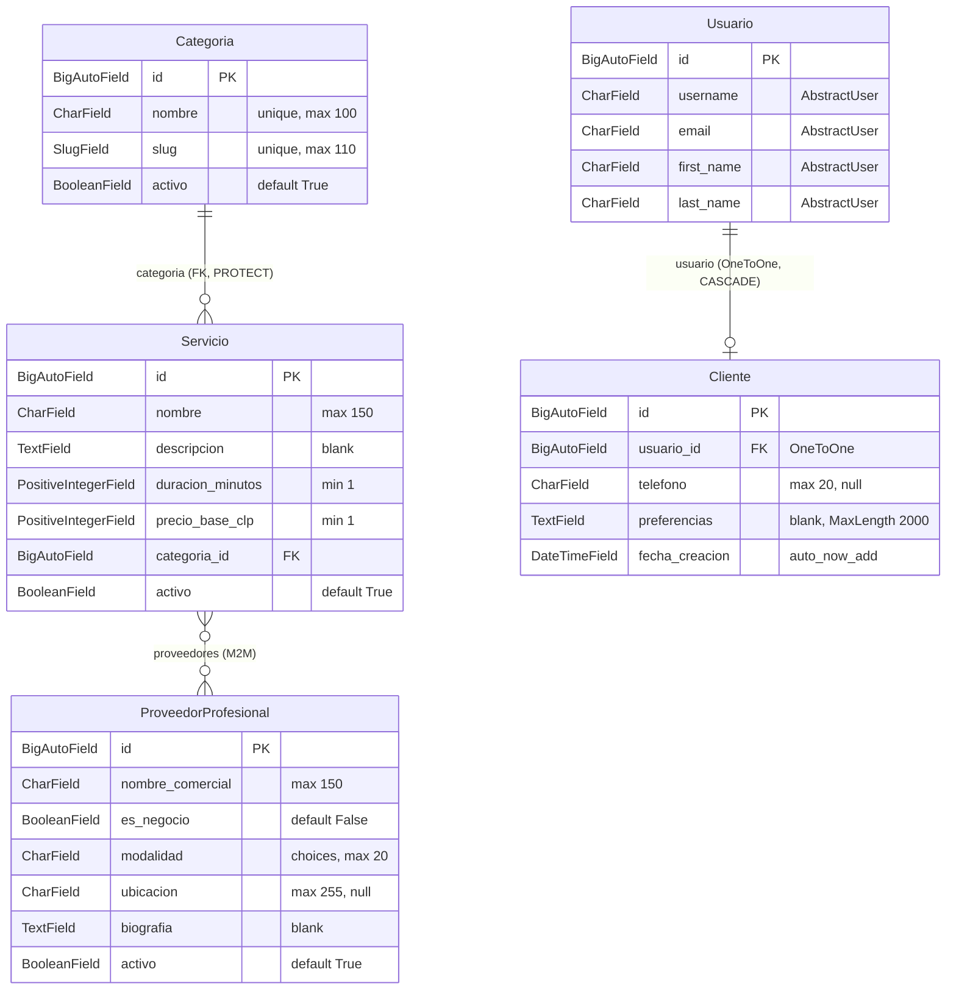
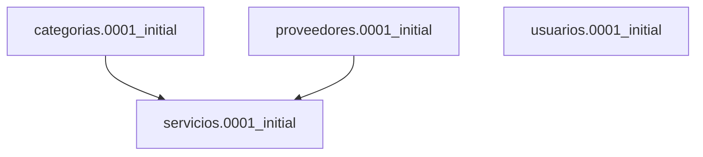
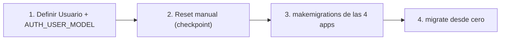

# Design Document

## Overview

Este documento describe el diseño del modelo de datos central de BeautyFull. El objetivo es implementar las cuatro apps de dominio que sirven de base para el flujo MVP completo (Cliente → selección de servicio → ubicación/fecha → profesional → reserva → pago → servicio completado → comisión → cashback → evaluación).

Las cuatro apps nuevas son:

- **`categorias`** — clasificación temática de servicios (modelo `Categoria`).
- **`servicios`** — catálogo de prestaciones concretas (modelo `Servicio`).
- **`usuarios`** — identidad de acceso y perfil de reservas (modelos `Usuario` y `Cliente`).
- **`proveedores`** — personas o negocios que ofrecen servicios (modelo `ProveedorProfesional`).

El alcance de esta spec es **exclusivamente**: definiciones de modelos, migraciones y configuración del Django Admin (`list_display`, `list_filter`, `search_fields`) para inspección manual. **No** se incluyen vistas, serializers, API REST, lógica de negocio (más allá del `save()` de slug en `Categoria`) ni templates de cara al usuario.

Cada app vive en `/apps/<nombre>/` y se registra en `INSTALLED_APPS` como `'apps.<nombre>'`, siguiendo el steering de arquitectura del proyecto. Este diseño respeta y no contradice ninguna de las cuatro Decisiones de Diseño Transversales ya aprobadas en el requirements:

- **Decisión 1** — Categorías planas (sin autorreferencia).
- **Decisión 2** — Custom User Model vía `AbstractUser` + `AUTH_USER_MODEL`.
- **Decisión 3** — `ProveedorProfesional` como entidad única con flag `es_negocio`.
- **Decisión 4** — `ManyToManyField` simple entre `Servicio` y `ProveedorProfesional` (modelo intermedio con precio/duración por proveedor diferido a spec futuro).

---

## Architecture

### Mapa de apps y relaciones

Las cuatro apps se relacionan de la siguiente forma. `usuarios` es independiente; `servicios` es la app que concentra las dependencias (referencia a `categorias` y `proveedores`).



### Relaciones clave

| Relación | Tipo | Detalle | Requirement |
|----------|------|---------|-------------|
| `Servicio.categoria` → `categorias.Categoria` | `ForeignKey` | `on_delete=PROTECT` | Req 2.2, Req 2.5 |
| `Servicio.proveedores` → `proveedores.ProveedorProfesional` | `ManyToManyField` | `blank=True`, `related_name='servicios'` | Req 2.3 |
| `Cliente.usuario` → `settings.AUTH_USER_MODEL` (`usuarios.Usuario`) | `OneToOneField` | `on_delete=CASCADE`, `related_name='perfil_cliente'` | Req 3.5 |
| `Usuario` hereda de `AbstractUser` | herencia | Custom User Model | Req 3.2 |

### Referencias por string y dependencias de migración

Para evitar imports cíclicos entre apps, `Servicio` referencia a sus modelos relacionados **por string** (Requirement 5.5):

- `categoria = models.ForeignKey('categorias.Categoria', ...)`
- `proveedores = models.ManyToManyField('proveedores.ProveedorProfesional', ...)`

De igual modo, `Cliente.usuario` referencia `settings.AUTH_USER_MODEL` (no importa directamente la clase `Usuario`).

Esto produce las siguientes dependencias entre migraciones (Requirement 5.3):



- `servicios.0001_initial` **declara dependencia** de `categorias.0001_initial` y `proveedores.0001_initial`.
- `usuarios.0001_initial` **no declara dependencia** de ninguna de las otras tres apps.

Django genera automáticamente estas `dependencies` al ejecutar `makemigrations` gracias a las referencias por string; no requieren edición manual.

### Orden recomendado de creación de apps

Para respetar las dependencias, el orden de creación e instalación es:

1. **`usuarios`** — primero, porque define `AUTH_USER_MODEL` (base para toda migración de `auth`) y es independiente.
2. **`categorias`** — sin dependencias de dominio.
3. **`proveedores`** — sin dependencias de dominio.
4. **`servicios`** — último, porque depende de `categorias` y `proveedores`.

> **Nota crítica de secuencia (Requirement 3.4):** Definir `Usuario` + `AUTH_USER_MODEL` debe ocurrir **antes** del procedimiento de reset de base de datos, y el reset debe ocurrir **antes** de generar/aplicar el resto de las migraciones. Ver sección "Procedimiento de reset de base de datos".

---

## Components and Interfaces

Esta sección documenta cada modelo, su AppConfig, campos, metadatos, `__str__` y configuración de Admin. Todas las clases usan PascalCase y todos los campos/archivos snake_case (Requirement 6.1, 6.2).

Cada app incluye además un `urls.py` que contiene únicamente `urlpatterns = []`, sin `path()` ni importación adicional (Requirement 6.5). Aplica de forma idéntica a las cuatro apps nuevas (`categorias`, `servicios`, `usuarios`, `proveedores`):

```python
urlpatterns = []
```

> **Nota:** A diferencia del `urls.py` de `apps/beauty_app` (que incluye `from django.urls import path`), estos `urls.py` **no** incorporan ese import, ya que `path` no se utiliza. Se omite el import no usado para cumplir estrictamente el Requirement 6.5.

---

### 3.1 App `categorias` — modelo `Categoria`

**AppConfig** (`apps/categorias/apps.py`):

```python
from django.apps import AppConfig


class CategoriasConfig(AppConfig):
    name = 'apps.categorias'
    label = 'categorias'
    default_auto_field = 'django.db.models.BigAutoField'
```

**Modelo** (`apps/categorias/models.py`) — Requirement 1.2, 1.3, 1.5:

```python
from django.db import models
from django.utils.text import slugify


class Categoria(models.Model):
    nombre = models.CharField(max_length=100, unique=True)
    slug = models.SlugField(max_length=110, unique=True, blank=True)
    activo = models.BooleanField(default=True)

    class Meta:
        verbose_name = 'categoría'
        verbose_name_plural = 'categorías'
        ordering = ['nombre']

    def __str__(self):
        return self.nombre

    def save(self, *args, **kwargs):
        if not self.slug:
            self.slug = self._generar_slug_unico()
        super().save(*args, **kwargs)

    def _generar_slug_unico(self):
        base = slugify(self.nombre)[:110]
        slug = base
        contador = 2
        # Excluir la propia instancia al comprobar unicidad (caso update).
        qs = Categoria.objects.exclude(pk=self.pk)
        while qs.filter(slug=slug).exists():
            sufijo = f'-{contador}'
            slug = f'{base[:110 - len(sufijo)]}{sufijo}'
            contador += 1
        return slug
```

**Lógica especial permitida (slug):** `Categoria` es el **único** modelo con `save()` sobrescrito (Requirement 6.3). El algoritmo de generación de slug:

1. Si el `slug` ya fue asignado manualmente (`self.slug` no vacío), no se regenera.
2. Se deriva el slug base desde `nombre` con `django.utils.text.slugify` (produce solo letras minúsculas ASCII, dígitos y guiones) y se trunca a 110 caracteres.
3. Se verifica unicidad contra la base (excluyendo la propia instancia para soportar `update`).
4. En caso de colisión se agrega sufijo incremental (`-2`, `-3`, …), recortando el base para que el total nunca supere 110 caracteres.

**Admin** (`apps/categorias/admin.py`) — Requirement 1.6:

```python
from django.contrib import admin

from .models import Categoria


@admin.register(Categoria)
class CategoriaAdmin(admin.ModelAdmin):
    list_display = ['nombre', 'slug', 'activo']
    list_filter = ['activo']
    search_fields = ['nombre', 'slug']
```

---

### 3.2 App `proveedores` — modelo `ProveedorProfesional`

**AppConfig** (`apps/proveedores/apps.py`):

```python
from django.apps import AppConfig


class ProveedoresConfig(AppConfig):
    name = 'apps.proveedores'
    label = 'proveedores'
    default_auto_field = 'django.db.models.BigAutoField'
```

**Modelo** (`apps/proveedores/models.py`) — Requirement 4.2, 4.3, 4.4:

```python
from django.db import models


class ModalidadChoices(models.TextChoices):
    A_DOMICILIO = 'a_domicilio', 'A domicilio'
    EN_LOCAL = 'en_local', 'En local'
    AMBOS = 'ambos', 'Ambos'


class ProveedorProfesional(models.Model):
    nombre_comercial = models.CharField(max_length=150)
    es_negocio = models.BooleanField(default=False)
    modalidad = models.CharField(
        max_length=20,
        choices=ModalidadChoices.choices,
        default=ModalidadChoices.A_DOMICILIO,
    )
    ubicacion = models.CharField(max_length=255, blank=True, null=True)
    biografia = models.TextField(max_length=500, blank=True)
    activo = models.BooleanField(default=True)

    class Meta:
        verbose_name = 'proveedor profesional'
        verbose_name_plural = 'proveedores profesionales'
        ordering = ['nombre_comercial']

    def __str__(self):
        return self.nombre_comercial
```

**Admin** (`apps/proveedores/admin.py`) — Requirement 4.5:

```python
from django.contrib import admin

from .models import ProveedorProfesional


@admin.register(ProveedorProfesional)
class ProveedorProfesionalAdmin(admin.ModelAdmin):
    list_display = ['nombre_comercial', 'es_negocio', 'modalidad', 'activo']
    list_filter = ['activo', 'modalidad', 'es_negocio']
    search_fields = ['nombre_comercial', 'biografia']
```

---

### 3.3 App `servicios` — modelo `Servicio`

**AppConfig** (`apps/servicios/apps.py`):

```python
from django.apps import AppConfig


class ServiciosConfig(AppConfig):
    name = 'apps.servicios'
    label = 'servicios'
    default_auto_field = 'django.db.models.BigAutoField'
```

**Modelo** (`apps/servicios/models.py`) — Requirement 2.2, 2.3, 2.4. Nótese el uso de **referencias por string** en `categoria` y `proveedores` (Requirement 5.5) y de `MinValueValidator` para el mínimo de 1 (Requirement 2.2):

```python
from django.core.validators import MinValueValidator
from django.db import models


class Servicio(models.Model):
    nombre = models.CharField(max_length=150)
    descripcion = models.TextField(blank=True)
    duracion_minutos = models.PositiveIntegerField(
        validators=[MinValueValidator(1)]
    )
    precio_base_clp = models.PositiveIntegerField(
        validators=[MinValueValidator(1)]
    )
    categoria = models.ForeignKey(
        'categorias.Categoria',
        on_delete=models.PROTECT,
        related_name='servicios',
    )
    proveedores = models.ManyToManyField(
        'proveedores.ProveedorProfesional',
        blank=True,
        related_name='servicios',
    )
    activo = models.BooleanField(default=True)

    class Meta:
        verbose_name = 'servicio'
        verbose_name_plural = 'servicios'
        ordering = ['categoria', 'nombre']

    def __str__(self):
        return self.nombre
```

> **Nota de diseño:** `PositiveIntegerField` ya impide valores negativos a nivel de base de datos. `MinValueValidator(1)` refuerza el mínimo de 1 (rechaza el valor 0) a nivel de `full_clean()` y formularios/Admin.

**Admin** (`apps/servicios/admin.py`) — Requirement 2.6:

```python
from django.contrib import admin

from .models import Servicio


@admin.register(Servicio)
class ServicioAdmin(admin.ModelAdmin):
    list_display = ['nombre', 'categoria', 'duracion_minutos', 'precio_base_clp', 'activo']
    list_filter = ['activo', 'categoria']
    search_fields = ['nombre', 'descripcion']
```

---

### 3.4 App `usuarios` — modelos `Usuario` y `Cliente`

**AppConfig** (`apps/usuarios/apps.py`):

```python
from django.apps import AppConfig


class UsuariosConfig(AppConfig):
    name = 'apps.usuarios'
    label = 'usuarios'
    default_auto_field = 'django.db.models.BigAutoField'
```

**Modelos** (`apps/usuarios/models.py`) — Requirement 3.2, 3.5, 3.6, 3.7:

```python
from django.conf import settings
from django.contrib.auth.models import AbstractUser
from django.core.validators import MaxLengthValidator
from django.db import models


class Usuario(AbstractUser):

    class Meta:
        verbose_name = 'usuario'
        verbose_name_plural = 'usuarios'

    def __str__(self):
        return self.get_full_name() or self.username


class Cliente(models.Model):
    usuario = models.OneToOneField(
        settings.AUTH_USER_MODEL,
        on_delete=models.CASCADE,
        related_name='perfil_cliente',
    )
    telefono = models.CharField(max_length=20, blank=True, null=True)
    preferencias = models.TextField(
        blank=True,
        validators=[MaxLengthValidator(2000)],
    )
    fecha_creacion = models.DateTimeField(auto_now_add=True)

    class Meta:
        verbose_name = 'cliente'
        verbose_name_plural = 'clientes'
        ordering = ['usuario__username']

    def __str__(self):
        return str(self.usuario)
```

**Notas de diseño:**

- `Usuario` hereda de `AbstractUser` **sin campos adicionales** en esta versión (Requirement 3.2). Solo se personalizan `Meta` y `__str__`.
- `Usuario.__str__` retorna `self.get_full_name() or self.username`: si `get_full_name()` retorna cadena vacía o `None`, se usa `username` (Requirement 3.6).
- `Cliente.__str__` delega a `str(self.usuario)` (Requirement 3.7).
- `Cliente.preferencias` usa `validators=[MaxLengthValidator(2000)]`. La validación del límite de 2000 caracteres ocurre a nivel de `full_clean()`/formularios (Admin), **no** a nivel de columna, porque `TextField` no impone límite en la base de datos (Requirement 3.5). Se importa `MaxLengthValidator` desde `django.core.validators`.

**Admin** (`apps/usuarios/admin.py`) — Requirement 3.8, 3.9. `Usuario` usa un Admin que **hereda de `UserAdmin`** de `django.contrib.auth.admin`; `Cliente` usa `admin.ModelAdmin`:

```python
from django.contrib import admin
from django.contrib.auth.admin import UserAdmin

from .models import Cliente, Usuario


@admin.register(Usuario)
class UsuarioAdmin(UserAdmin):
    list_display = ['username', 'email', 'first_name', 'last_name', 'is_staff', 'is_active']
    list_filter = ['is_staff', 'is_active', 'is_superuser']
    search_fields = ['username', 'email', 'first_name', 'last_name']


@admin.register(Cliente)
class ClienteAdmin(admin.ModelAdmin):
    list_display = ['usuario', 'telefono', 'fecha_creacion']
    list_filter = []
    search_fields = ['usuario__username', 'usuario__email', 'telefono']
```

> **Nota:** Al heredar de `UserAdmin`, `UsuarioAdmin` conserva los `fieldsets`, el formulario de creación con contraseña y toda la funcionalidad del Admin de auth. Solo se sobrescriben `list_display`, `list_filter` y `search_fields` según Requirement 3.8.

---

## Data Models

### Tablas generadas

| App | Modelo | Tabla en base de datos |
|-----|--------|------------------------|
| `categorias` | `Categoria` | `categorias_categoria` |
| `servicios` | `Servicio` | `servicios_servicio` |
| `servicios` | `Servicio.proveedores` (M2M) | `servicios_servicio_proveedores` (intermedia autogenerada) |
| `usuarios` | `Usuario` | `usuarios_usuario` |
| `usuarios` | `Cliente` | `usuarios_cliente` |
| `proveedores` | `ProveedorProfesional` | `proveedores_proveedorprofesional` |

El nombre corto de la tabla proviene del `label` de cada AppConfig (`categorias`, `servicios`, `usuarios`, `proveedores`), no de la ruta de importación `apps.<nombre>`.

### Tabla intermedia M2M

La relación `Servicio.proveedores` es un `ManyToManyField` **simple, sin `through` explícito**. Django autogenera la tabla intermedia `servicios_servicio_proveedores` con dos claves foráneas (`servicio_id`, `proveedorprofesional_id`).

Esto implementa fielmente la **Decisión 4** del requirements: el precio base y la duración son únicos por servicio (compartidos por todos los proveedores que lo ofrecen). La evolución a un modelo intermedio explícito (`through='OfertaProveedor'`) con `precio` y `duracion` por relación proveedor-servicio queda **diferida a un spec futuro de tarifas/ofertas** y **no** se implementa en esta spec.

---

## Configuración de settings

Se actualiza `beautyfull/settings/base.py` (Requirement 1.1, 2.1, 3.1, 3.3, 4.1, 5.6, 6.6). Dos cambios:

1. Agregar las cuatro apps a `INSTALLED_APPS` usando la ruta de importación completa `'apps.<nombre>'`.
2. Agregar `AUTH_USER_MODEL = 'usuarios.Usuario'`.

**Bloque `INSTALLED_APPS` resultante:**

```python
INSTALLED_APPS = [
    'django.contrib.admin',
    'django.contrib.auth',
    'django.contrib.contenttypes',
    'django.contrib.sessions',
    'django.contrib.messages',
    'django.contrib.staticfiles',
    # Apps del proyecto
    'apps.beauty_app',
    'apps.usuarios',
    'apps.categorias',
    'apps.proveedores',
    'apps.servicios',
]
```

**Configuración del Custom User Model** (se agrega junto al bloque de configuración del proyecto, por ejemplo cerca de `DEFAULT_AUTO_FIELD`):

```python
# Custom User Model (Decisión 2 — data-model-core)
AUTH_USER_MODEL = 'usuarios.Usuario'
```

> El orden de registro en `INSTALLED_APPS` coloca `apps.usuarios` primero entre las apps de dominio, en línea con el orden recomendado de creación. `apps.servicios` se registra al final porque depende de `categorias` y `proveedores`.

---

## Procedimiento de reset de base de datos (checkpoint manual)

Este procedimiento implementa el **Requirement 3.4** y el costo obligatorio declarado en la **Decisión 2** del requirements.

### Por qué es necesario

Adoptar `AUTH_USER_MODEL = 'usuarios.Usuario'` exige que dicho modelo esté definido **antes** de ejecutar la primera migración de `django.contrib.auth`. Como las migraciones de Spec 01 (`django-foundation`) **ya fueron aplicadas** en `db.sqlite3`, Django detectará un conflicto: no permite cambiar el modelo de usuario una vez que las tablas de `auth` existen (Requirement 3.12 — `manage.py migrate` retornaría un error de conflicto de tablas sin modificar el estado de la base).

### Pasos (irreversibles — requieren confirmación explícita del desarrollador)

1. Eliminar el archivo `db.sqlite3`.
2. Eliminar **todos** los archivos de migración con nombre distinto a `__init__.py` en las apps bajo `/apps/` (por ejemplo, `apps/beauty_app/migrations/0001_initial.py` y equivalentes). Se conserva cada `__init__.py`.
3. Ejecutar `manage.py makemigrations` seguido de `manage.py migrate` desde cero.

### Restricciones de gobernanza

- **Este paso NO se automatiza silenciosamente.** Destruye los datos de desarrollo y es irreversible.
- En la fase de **Tasks**, este procedimiento SHALL representarse como una **task manual explícita y separada**, con un **checkpoint de confirmación previo**, distinta de las tasks automatizables.
- Es aceptable únicamente porque la base SQLite de desarrollo es desechable y el proyecto no tiene entorno de producción activo. En producción, un cambio equivalente requeriría una migración de datos cuidadosa.

### Orden correcto



Primero se define `Usuario` y se configura `AUTH_USER_MODEL`; luego el reset manual; luego se generan y aplican las migraciones de las cuatro apps.

---

## Error Handling

### Integridad referencial

| Escenario | Comportamiento | Requirement |
|-----------|----------------|-------------|
| Eliminar una `Categoria` con `Servicio`s asociados | `on_delete=PROTECT` lanza `django.db.models.ProtectedError` e impide la eliminación | Req 2.5 |
| Eliminar un `Usuario` con `Cliente` asociado | `on_delete=CASCADE` elimina en cascada el `Cliente` asociado | Req 3.5 |
| Migrar con tablas de `auth` previas sin ejecutar el reset (Req 3.4) | `manage.py migrate` retorna error de conflicto de tablas sin modificar el estado de la base | Req 3.12 |

### Validaciones de campo

| Campo | Validación | Nivel | Requirement |
|-------|-----------|-------|-------------|
| `Categoria.nombre` | único, requerido, máx 100 | `unique` enforced en DB (ambos motores); requerido y max 100 solo vía `full_clean()`/form — `max_length` no enforced en SQLite dev, sí en PostgreSQL prod | Req 1.2, 1.4 |
| `Categoria.slug` | único, máx 110 | `unique` enforced en DB (ambos motores); max 110 solo vía `full_clean()`/form — no enforced en SQLite dev, sí en PostgreSQL prod | Req 1.2, 1.3 |
| `Servicio.duracion_minutos` | `MinValueValidator(1)` | `full_clean`/form | Req 2.2 |
| `Servicio.precio_base_clp` | `MinValueValidator(1)` | `full_clean`/form | Req 2.2 |
| `Cliente.preferencias` | `MaxLengthValidator(2000)` | `full_clean`/form (no DB) | Req 3.5 |
| `ProveedorProfesional.nombre_comercial` | requerido, máx 150 | requerido y max 150 solo vía `full_clean()`/form — `max_length` no enforced en SQLite dev, sí en PostgreSQL prod | Req 4.8 |
| `ProveedorProfesional.modalidad` | valor dentro de `ModalidadChoices` | `full_clean`/form | Req 4.9 |

> **Nota importante:** Las validaciones basadas en `validators` (`MinValueValidator`, `MaxLengthValidator`) y en `choices` se aplican en `full_clean()` y en formularios (incluido el Django Admin), **no** automáticamente en `save()`. Lo mismo ocurre con el campo requerido (`blank=False`) y con `max_length` de los `CharField`: un `save()`/`create()` directo **no** los rechaza. Además, `max_length` solo se enforce a nivel de columna en PostgreSQL (prod); SQLite (dev) **no** impone longitud de `VARCHAR`, por lo que un valor demasiado largo solo se rechaza al pasar por `full_clean()`/formularios. En cambio, `unique=True` sí se enforce en DB en ambos motores. El Django Admin invoca `full_clean()` al guardar desde formularios, por lo que la inspección manual desde el Admin ejercita estas validaciones.

---

## Correctness Properties

Esta sección formaliza las propiedades de corrección del sistema. *Una propiedad es una característica o comportamiento que debe cumplirse en todas las ejecuciones válidas del sistema — una afirmación formal sobre lo que el sistema debe hacer.*

La única lógica con comportamiento que varía significativamente con la entrada es la **generación de slug de `Categoria`** (el único `save()` sobrescrito permitido, Requirement 6.3). Es el candidato razonable a verificación por propiedades porque tiene entrada/salida clara sobre un espacio amplio de strings. El resto de los modelos son CRUD + configuración declarativa, cubiertos por tests basados en ejemplos.

### Property 1: Formato de slug válido

*Para toda* `Categoria` con `nombre` no vacío, el `slug` generado contiene exclusivamente letras minúsculas ASCII, dígitos y guiones, y su longitud no supera 110 caracteres.

**Validates: Requirements 1.3**

### Property 2: Unicidad de slug bajo colisión

*Para toda* secuencia de `Categoria`s cuyos nombres producen el mismo slug base, todos los `slug` almacenados resultantes son distintos entre sí (mediante sufijo incremental `-2`, `-3`, …), respetando siempre el límite de 110 caracteres.

**Validates: Requirements 1.3**

> Estas propiedades pueden validarse con property-based testing (PBT) usando `hypothesis`, con mínimo 100 iteraciones por propiedad. Su implementación es **opcional**: la cobertura mínima obligatoria se cumple con los tests unitarios basados en ejemplos descritos en Testing Strategy. Si se implementan como PBT, cada test debe etiquetarse con: **Feature: data-model-core, Property {número}: {texto}**.

---

## Testing Strategy

Esta feature consiste en definiciones de modelos, migraciones y configuración de Admin. Es esencialmente **CRUD + configuración declarativa** con una única pieza de lógica no trivial: la generación de slug de `Categoria`. Por lo tanto, la estrategia principal es de **tests basados en ejemplos (unit)** e **integración a nivel de comandos de gestión**, con **property-based testing acotado y opcional** únicamente para la generación de slug.

### Verificación a nivel de comandos (Requirement 5)

| Comando | Verificación | Requirement |
|---------|--------------|-------------|
| `manage.py check` | Cero issues con las 4 apps registradas; código de salida 0 | Req 5.1 |
| `manage.py makemigrations --check` | Código de salida 0; no genera migraciones nuevas | Req 5.2 |
| `manage.py migrate` | Aplica las migraciones respetando dependencias (`servicios` depende de `categorias` y `proveedores`; `usuarios` independiente) | Req 5.3, 1.8, 2.8, 3.11, 4.7 |
| `manage.py test` | 0 fallos y 0 errores; sin regresiones de Spec 01 | Req 5.4 |
| Inspección de settings | `settings.AUTH_USER_MODEL == 'usuarios.Usuario'` | Req 5.6, 3.3 |

### Tests unitarios mínimos por modelo (basados en ejemplos)

- **`Categoria`**: creación válida; `__str__` retorna `nombre`; generación automática de slug al guardar; colisión de slug produce sufijo `-2`, `-3`; unicidad de `nombre` y `slug` verificada vía `IntegrityError` en DB (ambos motores), mientras que el campo requerido y el `max_length` de `nombre`/`slug` se verifican invocando `full_clean()` (no `create()` directo, que en SQLite dev no rechazaría un valor demasiado largo).
- **`Servicio`**: creación válida con `categoria`; `__str__` retorna `nombre`; `MinValueValidator(1)` rechaza `duracion_minutos = 0` y `precio_base_clp = 0` vía `full_clean()`; eliminación de `Categoria` con servicios asociados lanza `ProtectedError` (Req 2.5); asociación M2M con proveedores.
- **`Usuario`**: creación vía `create_user`; `__str__` retorna `get_full_name()` cuando hay nombre y `username` cuando no.
- **`Cliente`**: creación con `OneToOne` a `Usuario`; `__str__` delega a `str(self.usuario)`; `MaxLengthValidator(2000)` rechaza `preferencias` de más de 2000 caracteres vía `full_clean()`; `CASCADE` elimina el `Cliente` al borrar el `Usuario`.
- **`ProveedorProfesional`**: creación válida; `__str__` retorna `nombre_comercial`; `modalidad` fuera de `ModalidadChoices` rechazada vía `full_clean()` (Req 4.9); `nombre_comercial` vacío/>150 rechazado invocando `full_clean()` para ejercitar el rechazo (Req 4.8), dado que un `save()`/`create()` directo en SQLite dev no rechazaría un `nombre_comercial` demasiado largo ni uno vacío.

**Balance:** mantener los tests unitarios acotados a ejemplos representativos, edge cases y condiciones de error. No sobre-poblar con casos redundantes.

### Property-based testing (opcional, acotado a la generación de slug)

> Las propiedades formales están definidas en la sección **Correctness Properties** (Property 1 — formato de slug válido; Property 2 — unicidad de slug bajo colisión). Si se implementan como PBT, usar `hypothesis` con mínimo 100 iteraciones por propiedad y etiquetar cada test con **Feature: data-model-core, Property {número}: {texto}**. Su implementación es opcional; la cobertura mínima obligatoria se cumple con los tests unitarios basados en ejemplos.

### Verificación manual en el Django Admin

Como panel de inspección (alcance explícito de la spec), verificar manualmente en `/admin/` que:

- Las cinco entradas de modelo aparecen registradas con sus `list_display`, `list_filter` y `search_fields` configurados.
- El Admin de `Usuario` (heredado de `UserAdmin`) permite crear usuarios con contraseña y conserva los `fieldsets` estándar de auth.
- Al guardar desde el Admin se ejercitan las validaciones (`MinValueValidator`, `MaxLengthValidator`, `choices`).
