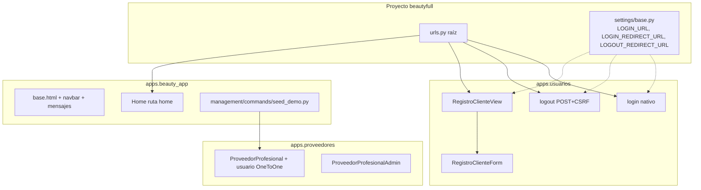
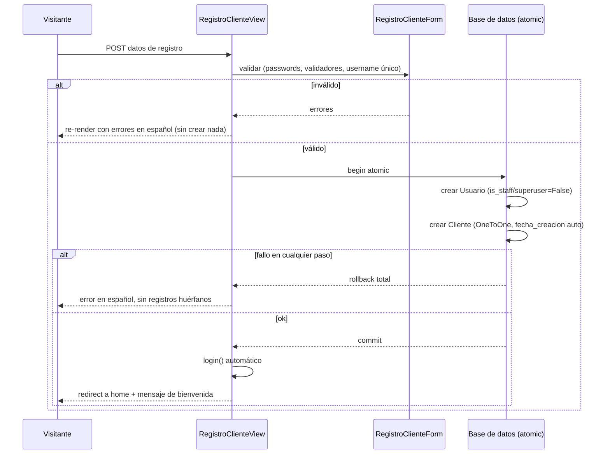
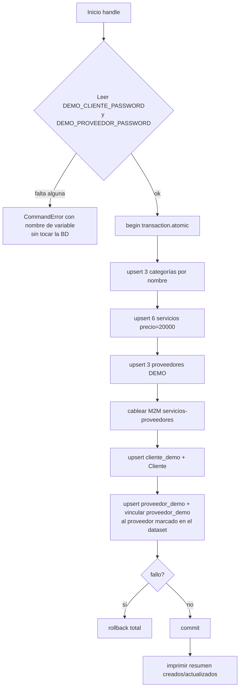
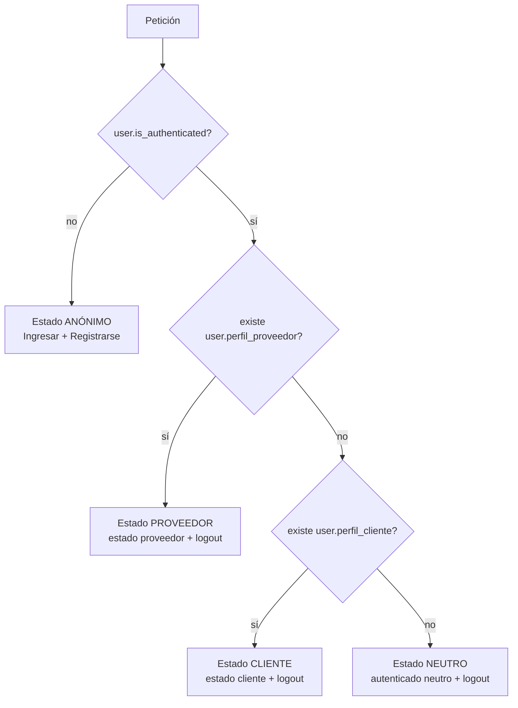
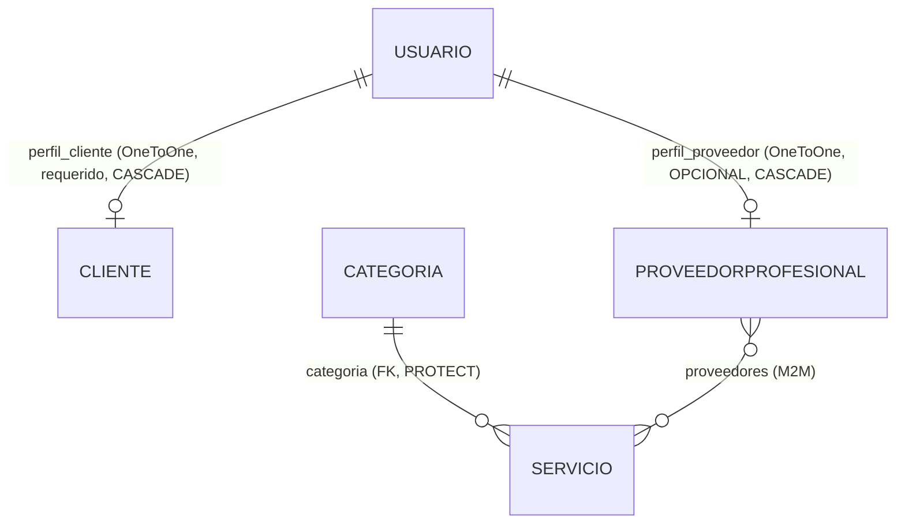

# Documento de Diseño

## Overview

Esta spec entrega la **fundación** de BeautyFull sobre la baseline ya verificada (modelos, settings, admin, templates y 31 tests en verde). Añade cinco piezas y una garantía de calidad, cada una trazada a los requerimientos R1–R6:

- **R1 — Identidad de proveedor:** un vínculo `OneToOneField` **opcional** de `ProveedorProfesional` hacia `AUTH_USER_MODEL`, su migración sin pérdida de datos y su edición en el admin.
- **R2 — Autenticación nativa:** login/logout usando el mecanismo nativo de Django, logout POST+CSRF, `Destino_Por_Defecto` determinista y manejo seguro de `next`.
- **R3 — Registro público de clientes:** formulario y vista que crean `Usuario` + `Cliente` de forma atómica, con auto-login.
- **R4 — Comando `seed_demo`:** management command idempotente que converge un dataset de demostración reproducible.
- **R5 — Shell visual base:** `base.html` evolucionado con navbar responsive mobile-first y bloque de mensajes, con 4 estados deterministas de navbar.
- **R6 — Calidad y regresión:** estrategia de testing con `django.test.TestCase`, trazabilidad AC → test y escenario integral.

El diseño respeta los Steering del workspace (`naming-conventions`, `frontend-conventions`, `architecture`, `execution-conventions`), que se **referencian** y no se repiten. No introduce frameworks JS, CDN, APIs públicas, PostgreSQL ni ningún elemento fuera del alcance declarado en el requirements.

### Principios de diseño transversales

- **No se crea un sistema de roles.** El estado de un usuario se deriva en tiempo de petición preguntando por la existencia de las relaciones inversas `perfil_proveedor` y `perfil_cliente` (R1.8, R5.10).
- **Sin exclusión mutua** entre `Cliente` y `ProveedorProfesional` (R1.8).
- **Secretos exclusivamente por entorno** vía `python-decouple`, sin hardcoding (R4.8, `architecture`).
- **Renderizado server-side** con Django Templates; CSS y JS siempre en archivos bajo `/static/` (R5, `frontend-conventions`).

---

## Architecture

### Reparto de responsabilidades por app

| Pieza | App responsable | Justificación |
|-------|-----------------|---------------|
| Vínculo `Usuario` ⇄ `ProveedorProfesional` (R1) | `apps.proveedores` | El campo pertenece al modelo `ProveedorProfesional`. |
| Vistas/forms de login, logout y registro (R2, R3) | `apps.usuarios` | La autenticación y el alta de clientes giran en torno a `Usuario` y `Cliente`, ambos definidos en `usuarios`. Mantiene la app autocontenida. |
| Comando `seed_demo` (R4) | `apps.beauty_app` | `beauty_app` es la app núcleo compartida (`architecture`). El seed cruza varios dominios (categorías, servicios, proveedores, usuarios); ubicarlo en la app compartida evita acoplar un dominio a los demás. |
| `base.html`, componentes globales (navbar, mensajes), Home (R5) | `apps.beauty_app` | `base.html` y `components/` ya residen (o deben residir) en `beauty_app` según `frontend-conventions`. El Home es contenido global, no de dominio. |

### Estructura de URLs

Ruta raíz `beautyfull/urls.py` incluye las URLconf de las apps implicadas. Todas las rutas con nombre viven namespaced o directamente con nombres estables resolubles (R5.5):

```
beautyfull/urls.py
  ''            → include('apps.beauty_app.urls')   # home
  ''            → include('apps.usuarios.urls')      # login, logout, registro
  'admin/'      → admin.site.urls
```

Rutas con nombre estables requeridas (R5.5):

| Nombre | App | Vista | Método(s) |
|--------|-----|-------|-----------|
| `home` | beauty_app | `HomeView` / vista función | GET |
| `login` | usuarios | login (nativo adaptado) | GET, POST |
| `logout` | usuarios | logout | POST (CSRF) |
| `registro` | usuarios | `RegistroClienteView` | GET, POST |

> Nota de nombrado (`naming-conventions`): clases de vista en PascalCase (`RegistroClienteView`), nombres de ruta y archivos en snake_case (`urls.py`, nombre `registro`).

### Adiciones a settings (`beautyfull/settings/base.py`)

El diseño define `Destino_Por_Defecto = ruta con nombre home`. Para que el mecanismo nativo de Django lo respete, se agregan a `base.py` (compartido por dev y prod):

```python
LOGIN_URL = 'login'            # a dónde enviar a un usuario no autenticado
LOGIN_REDIRECT_URL = 'home'    # Destino_Por_Defecto tras login exitoso (R2.8)
LOGOUT_REDIRECT_URL = 'home'   # Destino_Por_Defecto tras logout (R2.9)
```

No se modifican `MIDDLEWARE`, `TEMPLATES` (ya incluye los context processors `request`, `auth`, `messages`), `AUTH_USER_MODEL`, ni la configuración de estáticos: todo lo necesario ya está presente en la baseline.

### Diagrama de alto nivel



---

## Components and Interfaces

### 1. Modelo y migración — vínculo de proveedor (R1)

**Cambio en `apps/proveedores/models.py`:** agregar a `ProveedorProfesional` el campo opcional:

```python
usuario = models.OneToOneField(
    settings.AUTH_USER_MODEL,
    on_delete=models.CASCADE,
    null=True,
    blank=True,
    related_name='perfil_proveedor',
)
```

Decisiones y trazabilidad:

- `null=True, blank=True` → permite guardar sin `Usuario` (R1.2) y hace opcional el vínculo.
- `related_name='perfil_proveedor'` → distinto de `perfil_cliente` (R1.1).
- `on_delete=CASCADE` → al borrar el `Usuario` se borra el `ProveedorProfesional` asociado, replicando el comportamiento de `Cliente` (R1.4).
- La restricción de unicidad propia del `OneToOneField` garantiza que un mismo `Usuario` no pueda vincularse a dos proveedores: el segundo guardado se rechaza por `IntegrityError`/`ValidationError`, preservando el vínculo previo (R1.3).

**Migración (nueva, en `apps/proveedores/migrations/`):** `AddField` del campo `usuario` como nullable. Al ser `null=True`, Django **no** solicita valor de relleno y todas las filas existentes quedan con `usuario = NULL` sin backfill ni pérdida de datos (R1.6).

**Diferencia justificada frente a `Cliente` (R1.7):** se documenta en el docstring del campo/modelo que el vínculo de proveedor es **opcional** (`null/blank`) porque no todo proveedor necesita cuenta, mientras que el de `Cliente` es **requerido**; ambos comparten `on_delete=CASCADE`. Es una decisión declarativa (sin test de comportamiento, R6.4).

**No se introduce** exclusión mutua `Cliente`/`ProveedorProfesional` ni sistema de roles (R1.8).

### 2. Admin — edición del vínculo (R1.5)

En `apps/proveedores/admin.py`, `ProveedorProfesionalAdmin` expone `usuario` como campo editable (incluyéndolo en `fields`/`fieldsets` o dejándolo disponible por defecto). El admin permite:

- **Asociar:** seleccionar un `Usuario` del selector y guardar.
- **Desasociar:** dejar la selección vacía y guardar, persistiendo `NULL`.

Se añade `usuario` a `list_display` (opcional, para visibilidad) y a `raw_id_fields`/autocomplete si la lista de usuarios crece; a nivel de diseño basta con exponerlo como editable. Se preservan `list_filter` y `search_fields` existentes.

### 3. Autenticación nativa (R2) — `apps.usuarios`

Se usa el stack de autenticación nativo de Django (login por `username`, R2 preámbulo), sin reimplementarlo:

- **Login:** vista basada en `django.contrib.auth.views.LoginView` con `template_name` propio namespaced. Autentica credenciales válidas e inicia sesión (R2.1). Ante credenciales inválidas, `AuthenticationForm` no inicia sesión y re-renderiza la página con el error; se garantiza un mensaje visible **en español** (R2.2) y se preserva la sesión previa sin crear una autenticada (R2.3). El idioma de los mensajes se obtiene vía `LANGUAGE_CODE='es-cl'` ya configurado.
- **Logout:** vista basada en `django.contrib.auth.views.LogoutView`, que por diseño de Django moderno **solo acepta POST**. Un GET no cierra la sesión (R2.4, R2.5). El control en la UI es un `<form method="post">` con `` apuntando a `logout` (R2.6, R5.7–R5.9).
- **Manejo de `next` (R2.7, R2.8):** `LoginView` valida el destino con la semántica de `django.utils.http.url_has_allowed_host_and_scheme` (restringida a `allowed_hosts` del propio sitio y, en producción, `require_https`). Si `next` es una ruta relativa interna segura, redirige allí (R2.7); si está ausente, vacío o apunta a un host/esquema externo, redirige a `LOGIN_REDIRECT_URL = home` = `Destino_Por_Defecto` (R2.8).
- **Redirección tras logout (R2.9):** `LogoutView` redirige a `LOGOUT_REDIRECT_URL = home`.
- **Usuario ya autenticado (R2.10):** `LoginView` nativa redirige por defecto cuando el usuario ya está autenticado (`redirect_authenticated_user=True`); la vista de `registro` replica esta guarda (si `request.user.is_authenticated`, redirige a `home`) para no mostrar los formularios.
- **Plantilla (R2.11):** la plantilla de login extiende `base.html`.

### 4. Registro público de clientes (R3) — `apps.usuarios`

**Formulario `RegistroClienteForm`** (en `apps/usuarios/forms.py`). Campos:

| Campo | Origen | Obligatorio | Notas |
|-------|--------|-------------|-------|
| `username` | `Usuario` | Sí | Rechaza duplicados (R3.9). |
| `password1` | `Usuario` | Sí | Validado por los validadores activos de Django (R3.3). |
| `password2` | confirmación | Sí | Debe coincidir con `password1` (R3.4). |
| `telefono` | `Cliente` | No | `CharField` opcional. |
| `preferencias` | `Cliente` | No | `TextField`, `MaxLengthValidator(2000)`. |

El formulario reutiliza la mecánica de `UserCreationForm` (hash de contraseña, validación de coincidencia y de validadores) extendida con los campos opcionales de `Cliente`. Errores en español vía mensajes de Django y `error_messages` propios donde haga falta.

**Vista `RegistroClienteView`** (en `apps/usuarios/views.py`):

- Solo crea cuentas de tipo cliente: un `Usuario` + su `Cliente` (`related_name='perfil_cliente'`), sin crear ningún `ProveedorProfesional` (R3.1, R3.5).
- Fuerza `is_staff=False`, `is_superuser=False`, sin grupos ni permisos (R3.5).
- Crea ambos registros **atómicamente** dentro de un `with transaction.atomic():` (R3.6); `fecha_creacion` del `Cliente` se fija automáticamente por `auto_now_add` (R3.6). Ninguna escritura —incluida cualquier llamada parcial a `form.save()`— ocurre antes de abrir `transaction.atomic()`.
- Si falla la creación de `Usuario` o `Cliente`, la transacción revierte por completo: no quedan `Usuario` huérfanos ni `Cliente` sin `Usuario`; se muestra error en español vía framework de mensajes (R3.7).
- En éxito: `login()` automático del `Usuario`, redirección a `Destino_Por_Defecto` (`home`) y mensaje de bienvenida en español vía `messages` (R3.8).
- Datos inválidos o `username` ya existente → re-render con errores en español, sin crear registros (R3.9).
- Si el usuario ya está autenticado, redirige a `home` sin mostrar el formulario (R2.10).
- Plantilla de registro extiende `base.html` (R3.10).



### 5. Comando `seed_demo` (R4) — `apps/beauty_app/management/commands/seed_demo.py`

Estructura: paquete `management/commands/` dentro de `apps.beauty_app`. Clase `Command(BaseCommand)` con `handle()`.

**Lectura de contraseñas (R4.8, R4.9):** al inicio de `handle()`, antes de cualquier escritura, se leen desde entorno vía `python-decouple` **sin fallback**:

```python
from decouple import config
DEMO_CLIENTE_PASSWORD = config('DEMO_CLIENTE_PASSWORD')
DEMO_PROVEEDOR_PASSWORD = config('DEMO_PROVEEDOR_PASSWORD')
```

Si falta alguna variable (obligatoria, sin fallback), `config()` lanza `decouple.UndefinedValueError`; se captura y se termina con `CommandError` indicando el **nombre** de la variable ausente, **antes** de abrir la transacción, dejando la BD sin cambios (R4.9).

**Nombres de variables de entorno:** `DEMO_CLIENTE_PASSWORD` y `DEMO_PROVEEDOR_PASSWORD`. Se documentan en `.env.example` **sin valores** (R4.10).

**Transacción (R4.7):** toda la escritura ocurre dentro de un único `with transaction.atomic():`; ante cualquier fallo, rollback total.

**Claves naturales e idempotencia (R4.5, R4.6):** se usa `update_or_create` / `get_or_create` con claves naturales estables para converger en cada ejecución sin duplicar ni tocar registros ajenos:

| Entidad | Clave natural | Marcador demo |
|---------|---------------|---------------|
| `Categoria` | `nombre` (único) | nombres fijos |
| `Servicio` | `(categoria, nombre)` | — |
| `ProveedorProfesional` | `nombre_comercial` | sufijo/marcador estable, p. ej. `"[DEMO]"` |
| `Usuario` demo | `username` (`cliente_demo`, `proveedor_demo`) | username fijo |

**Dataset de demostración (R4.1):** 3 categorías y 6 servicios, todos con `precio_base_clp = 20000`:

| Categoría | Servicios |
|-----------|-----------|
| Peluquería | Corte Niño, Corte Adulto, Coloración |
| Manicure | Manicure Permanente |
| Masajes | Masaje Relajante, Masaje Descontracturante |

**Proveedores (R4.2):** exactamente 3, con nombres ficticios que incluyen un marcador demo estable (p. ej. `"Studio Aurora [DEMO]"`, `"Bella Manos [DEMO]"`, `"Relax Zen [DEMO]"`).

**Cableado M2M (R4.3):** usando `Servicio.proveedores`, se asigna ≥1 proveedor a cada uno de los 6 servicios, y ≥1 servicio con ≥2 proveedores. El reparto concreto se fija de forma determinista en la implementación.

**Usuarios demo (R4.4):**
- `cliente_demo`: `Usuario` + `Cliente` asociado.
- `proveedor_demo`: `Usuario` vinculado por el `OneToOneField` de R1 a **exactamente uno** de los 3 proveedores demo.
- **Criterio determinista de selección (definido aquí, R4.4):** la estructura estática de datos del comando distingue dos conceptos para cada proveedor demo, sin agregar ningún campo nuevo al modelo:
  - **(a) identidad persistente:** la clave natural real del modelo —para `ProveedorProfesional` es `nombre_comercial`—, usada para localizar-o-crear el registro en cada ejecución.
  - **(b) rol en el dataset:** un marcador explícito que vive **únicamente** en la estructura de datos en-Python del comando (p. ej. un flag booleano `recibe_cuenta_demo=True` sobre **exactamente una** de las tres entradas de proveedor en el literal de lista/dict que define los proveedores demo), que indica cuál de los 3 proveedores recibe la cuenta `proveedor_demo`.
  - El criterio es **determinista y estable entre ejecuciones** porque el flag está **hard-coded en la definición del dataset del comando**, y **no** se deriva de datos editables como `nombre_comercial` (que puede modificarse desde el admin).

**Convergencia (R4.6):** en una segunda ejecución, cada registro converge al estado definido —incluyendo `precio_base_clp = 20000` y la contraseña vigente en las variables de entorno (se re-aplica `set_password`)— sin duplicados y sin crear/modificar registros no-demo.

**Política de convergencia:** `seed_demo` administra **únicamente** las claves naturales de su propio dataset; **nunca** elimina registros ajenos; si ya existe un registro con esa clave natural lo trata como la **misma entidad lógica** y converge **solo** los campos que el dataset define, dejando todo lo demás intacto. Esta política no introduce ningún campo `is_demo` ni ningún campo nuevo en los modelos.

> **Nota:** esta semántica es válida para el entorno de demo actual; **no** se asume segura para una base con datos reales en producción — esa política se decidirá en el checkpoint AWS.

**Resumen de salida (R4.11):** al finalizar con éxito, imprime vía `self.stdout.write` el conteo de registros **creados** y **actualizados** (acumulados por categoría/servicio/proveedor/usuario).



### 6. Shell visual base (R5) — `apps.beauty_app`

**`base.html` (R5.1, R5.2):** se evoluciona preservando `lang="es"`, los bloques existentes (`title`, `extra_css`, `content`, `extra_js`) y la carga de `css/main.css` y `js/main.js`. Se añade:
- Una **navbar responsive mobile-first** incluida vía ``.
- Un **bloque de mensajes** incluido vía ``.

Todo el CSS nuevo va en `/static/css/` y todo el JS (p. ej. toggle del menú móvil) en `/static/js/`; **sin** `style=""` ni `<script>` inline (R5.1, `frontend-conventions`). Sin frameworks externos ni CDN.

**Componentes globales** (en `apps/beauty_app/templates/components/`, per `frontend-conventions`):
- `navbar.html` — navegación con los 4 estados.
- `messages.html` — recorre `messages`; **no** renderiza ningún elemento cuando no hay mensajes activos (R5.3).

**Home (R5.4):** página mínima en la ruta con nombre `home`, **sin** contenido de catálogo (sin listados de servicios, categorías ni proveedores). Plantilla de dominio namespaced en `apps/beauty_app/templates/beauty_app/home.html` que extiende `base.html`.

**Regla de estado de navbar (R5.6–R5.10):** se computa **server-side** sin sistema de roles, evaluando en orden de prioridad la existencia de relaciones inversas sobre `request.user`:



- **ANÓNIMO (R5.6):** muestra exactamente *Ingresar* (ruta `login`) y *Registrarse* (ruta `registro`); sin control de logout ni estado de sesión.
- **PROVEEDOR (R5.7):** muestra estado de proveedor y logout; oculta Ingresar/Registrarse.
- **CLIENTE (R5.8):** muestra estado de cliente y logout; oculta Ingresar/Registrarse.
- **NEUTRO (R5.9):** usuario autenticado sin `perfil_proveedor` ni `perfil_cliente` (p. ej. superusuario) → estado autenticado neutro y logout.
- La **prioridad anónimo → proveedor → cliente → neutro** selecciona exactamente **un** estado por petición (R5.10).

**Decisión arquitectónica (cerrada aquí):** la lógica de estado de la navbar es **server-side** y queda **localizada en el template del componente** `apps/beauty_app/templates/components/navbar.html`, usando el usuario provisto por el contexto de template y las relaciones inversas **reales** `perfil_proveedor` / `perfil_cliente`. Explícitamente: **no** se agrega ningún context processor, **no** se crea ninguna etiqueta de template personalizada y **no** se introduce ningún sistema de roles. Se mantiene el orden de prioridad **anónimo → proveedor → cliente → neutro**.

La **sintaxis de template exacta** (la forma precisa de consultar la existencia de cada relación inversa en el template) **no se fija en el diseño**: será verificada por Kiro contra los modelos y templates reales en el momento de la implementación. En todos los estados autenticados, el logout es un `<form method="post">` con `` hacia `logout` (R5.7–R5.9), coherente con R2.6.

**Rutas con nombre (R5.5):** `home`, `login`, `logout`, `registro`, todas resolubles por nombre.

---

## Data Models

### Cambio de esquema (R1)

Único cambio de modelo de la spec: nuevo campo en `ProveedorProfesional`.



| Modelo | Campo nuevo | Tipo | Atributos |
|--------|-------------|------|-----------|
| `ProveedorProfesional` | `usuario` | `OneToOneField(AUTH_USER_MODEL)` | `null=True, blank=True, on_delete=CASCADE, related_name='perfil_proveedor'` |

Comparación de los dos vínculos (R1.7):

| Aspecto | `Cliente.usuario` | `ProveedorProfesional.usuario` |
|---------|-------------------|--------------------------------|
| Obligatoriedad | Requerido | Opcional (`null/blank`) |
| `on_delete` | CASCADE | CASCADE |
| `related_name` | `perfil_cliente` | `perfil_proveedor` |

Ningún otro modelo (`Servicio`, `Categoria`, `Cliente`, `Usuario`) cambia su esquema.

### Forma del dataset de demostración (R4)

- 3 `Categoria`: Peluquería, Manicure, Masajes.
- 6 `Servicio`, todos `precio_base_clp = 20000`, con la distribución por categoría indicada arriba.
- 3 `ProveedorProfesional` demo (marcador `[DEMO]`), cableados por M2M a los servicios (cada servicio ≥1 proveedor; ≥1 servicio con ≥2 proveedores).
- `cliente_demo` (`Usuario` + `Cliente`) y `proveedor_demo` (`Usuario` vinculado al proveedor demo marcado con `recibe_cuenta_demo=True` en el dataset del comando).

---

## Correctness Properties

> **Aplicabilidad de PBT:** El requirements declara explícitamente *«esta Spec no requiere property-based tests»* (Nota final de R6). Además, el alcance es CRUD/ORM de Django, autenticación nativa, renderizado server-side de templates y un management command con efectos de I/O — dominios para los que la guía del workflow desaconseja PBT y recomienda tests de ejemplo e integración. Por lo tanto **se omiten las propiedades universales (PBT)** y, en su lugar, se listan **invariantes de diseño** verificables mediante `django.test.TestCase`, cada una trazada a su requerimiento. La verificación concreta se detalla en Testing Strategy.

Estas son **invariantes de diseño** verificadas mediante tests de ejemplo/integración con `django.test.TestCase` (no PBT). Se formulan como propiedades para trazabilidad:

#### Property 1: Opcionalidad del vínculo de proveedor
Un `ProveedorProfesional` puede guardarse con `usuario = NULL` sin error de validación. (R1.2)

#### Property 2: Unicidad del vínculo
Asociar a un segundo `ProveedorProfesional` un `Usuario` ya vinculado es rechazado, y el vínculo previo permanece intacto. (R1.3)

#### Property 3: Cascada
Al eliminar un `Usuario` vinculado, su `ProveedorProfesional` también se elimina. (R1.4)

#### Property 4: Autenticación
Credenciales válidas inician sesión; credenciales inválidas no la inician y preservan el estado previo. (R2.1–R2.3)

#### Property 5: Logout seguro
POST con CSRF cierra sesión y redirige a `home`; GET no cierra sesión. (R2.4, R2.5, R2.9)

#### Property 6: `next` seguro
Un `next` interno relativo redirige allí; un `next` externo o ausente redirige a `home`. (R2.7, R2.8)

#### Property 7: Atomicidad del registro
Un registro válido crea `Usuario`+`Cliente`; un fallo intermedio no deja registros huérfanos. (R3.6, R3.7)

#### Property 8: Cuenta no privilegiada
El registro crea `is_staff=False`, `is_superuser=False`, sin grupos/permisos, sin `ProveedorProfesional`. (R3.5)

#### Property 9: Idempotencia del seed
Ejecutar `seed_demo` dos veces no crea duplicados y converge `precio_base_clp=20000` y contraseñas vigentes. (R4.6)

#### Property 10: Fail-before-write del seed
Faltando una variable de contraseña, el comando aborta sin tocar la BD, nombrando la variable. (R4.9)

#### Property 11: Determinismo navbar
Cada petición selecciona exactamente uno de los 4 estados según la prioridad anónimo → proveedor → cliente → neutro. (R5.10)

---

## Error Handling

| Escenario | Manejo | Requisito |
|-----------|--------|-----------|
| Credenciales de login inválidas | `AuthenticationForm` no autentica; se re-renderiza login con mensaje de error visible en español; sesión previa intacta | R2.2, R2.3 |
| Logout vía GET | `LogoutView` nativa no cierra sesión; estado sin cambios | R2.5 |
| `next` externo o malformado | Validación con `url_has_allowed_host_and_scheme`; se ignora y se usa `home` | R2.8 |
| `username` duplicado o datos inválidos en registro | Form inválido; errores en español; ningún registro creado | R3.9 |
| Contraseñas que no coinciden | Error en español "las contraseñas no coinciden"; sin registros | R3.4 |
| Fallo durante la transacción de registro | `transaction.atomic` revierte todo; mensaje de error en español; sin huérfanos | R3.7 |
| Variable de contraseña demo ausente | `CommandError` antes de escribir, nombrando la variable; BD sin cambios | R4.9 |
| Fallo intermedio en `seed_demo` | `transaction.atomic` revierte toda la ejecución (rollback total) | R4.7 |
| Sin mensajes activos | El bloque de mensajes no renderiza ningún elemento | R5.3 |

Principios: validación en formularios y modelo (no en templates); transacciones atómicas para operaciones multi-registro; mensajes de usuario en español vía el framework de mensajes; errores de operación (seed) vía `CommandError` con causa clara.

---

## Testing Strategy

**Marco:** `django.test.TestCase` / `Client` de Django. **No** se usan property-based tests (R6 Nota; alcance no apto para PBT). Tests de ejemplo para casos concretos, de integración para flujos (login, registro, seed) y el escenario integral. La suite debe mantener los **31 tests existentes en verde** (R6.1), `manage.py check` con salida 0 (R6.2) y `makemigrations --check` sin pendientes (R6.3). Se escribe **al menos un test por cada AC verificable** de R1–R5, excluyendo criterios declarativos/documentales como R1.7 (R6.4); un test puede cubrir varios AC relacionados si preserva la trazabilidad.

### Trazabilidad AC → test

| AC | Qué verifica el test | Tipo |
|----|----------------------|------|
| R1.1 | El campo `usuario` existe con `related_name='perfil_proveedor'`, `null/blank`, CASCADE | ejemplo/introspección |
| R1.2 | Guardar `ProveedorProfesional` sin `usuario` no lanza error | ejemplo |
| R1.3 | Asociar un `Usuario` ya vinculado a otro proveedor es rechazado; vínculo previo intacto | ejemplo |
| R1.4 | Borrar el `Usuario` borra su `ProveedorProfesional` (CASCADE) | ejemplo |
| R1.5 | El admin expone `usuario` como editable (asociar/desasociar) | ejemplo (admin) |
| R1.6 | La migración deja filas existentes con `usuario=NULL` (nullable, sin backfill) | migración/ejemplo |
| R1.7 | *(Declarativo — excluido de test, documentado en modelo)* | — |
| R1.8 | No hay exclusión mutua: un `Usuario` puede no tener ni cliente ni proveedor, y el sistema no fuerza roles | ejemplo |
| R2.1 | Login con credenciales válidas inicia sesión | integración |
| R2.2 | Login inválido muestra error en español y no inicia sesión | integración |
| R2.3 | Login fallido preserva estado de sesión previo | integración |
| R2.4/R2.6 | Logout funciona solo vía POST con CSRF (control es form POST) | integración |
| R2.5 | Logout vía GET no cierra sesión | integración |
| R2.7 | `next` interno seguro redirige a ese destino | integración |
| R2.8 | `next` ausente/externo redirige a `home` | integración |
| R2.9 | Logout POST redirige a `home` | integración |
| R2.10 | Usuario autenticado que pide login/registro es redirigido a `home` | integración |
| R2.11 | Plantilla de login extiende `base.html` | ejemplo (render) |
| R3.1/R3.5 | Registro crea solo `Usuario`+`Cliente`, no privilegiado, sin proveedor | integración |
| R3.2 | El form pide los campos obligatorios y opcionales esperados | ejemplo |
| R3.3 | Contraseña validada por validadores de Django | integración |
| R3.4 | Contraseñas distintas → error en español, sin registros | integración |
| R3.6 | Creación atómica; `fecha_creacion` auto | integración |
| R3.7 | Fallo en transacción → rollback total, sin huérfanos | integración |
| R3.8 | Éxito → auto-login + redirect `home` + mensaje de bienvenida | integración |
| R3.9 | `username` duplicado/datos inválidos → errores en español, sin registros | integración |
| R3.10 | Plantilla de registro extiende `base.html` | ejemplo (render) |
| R4.1 | 3 categorías y 6 servicios con `precio_base_clp=20000` | integración (comando) |
| R4.2 | 3 proveedores demo con marcador estable | integración |
| R4.3 | Cada servicio ≥1 proveedor; ≥1 servicio con ≥2 | integración |
| R4.4 | `cliente_demo` y `proveedor_demo`; vínculo al proveedor marcado con `recibe_cuenta_demo=True` en el dataset del comando | integración |
| R4.5/R4.6 | Segunda ejecución converge sin duplicar ni tocar no-demo (idempotencia) | integración |
| R4.7 | Fallo intermedio → rollback total | integración |
| R4.8/R4.9 | Contraseñas desde env sin fallback; variable ausente → aborta sin escribir, nombrando la variable | integración |
| R4.10 | `.env.example` documenta `DEMO_CLIENTE_PASSWORD` y `DEMO_PROVEEDOR_PASSWORD` sin valores | ejemplo (archivo) |
| R4.11 | Salida con conteo de creados/actualizados | integración |
| R5.1/R5.2 | `base.html` conserva bloques, `lang="es"`, carga estáticos; navbar sin inline style/script | ejemplo (render) |
| R5.3 | Bloque de mensajes muestra mensajes activos y nada cuando no hay | integración |
| R5.4 | Home resoluble por `home`, sin catálogo | integración |
| R5.5 | `home`, `login`, `logout`, `registro` resuelven por nombre (`reverse`) | ejemplo |
| R5.6 | Navbar anónimo: Ingresar + Registrarse; sin logout | integración |
| R5.7 | Navbar proveedor: estado proveedor + logout; sin Ingresar/Registrarse | integración |
| R5.8 | Navbar cliente: estado cliente + logout | integración |
| R5.9 | Navbar neutro (superusuario): autenticado neutro + logout | integración |
| R5.10 | Exactamente un estado por petición según prioridad | integración |

### Escenario integral (R6.5)

Un test de flujo ejecuta la secuencia **`seed_demo` → registro → logout → login** y, en cada paso, verifica que la navbar refleje el estado de autenticación correspondiente:
- Tras **registro**: navbar en estado cliente (autenticado).
- Tras **logout**: navbar en estado anónimo.
- Tras **login**: navbar nuevamente en estado autenticado.

### Verificación de no-regresión (R6.1, R6.2, R6.3, R6.6)

- `manage.py test` → 31 tests existentes + nuevos, 0 fallos / 0 errores.
- `manage.py check` → salida 0, sin warnings de checks.
- `manage.py makemigrations --check` → 0 migraciones pendientes (la única migración nueva es la de R1, ya generada).
- Si cualquiera de estas verificaciones falla, la fundación se considera **no integrable** y no se marca como aprobada (R6.6).

> Conforme a `execution-conventions`, la ejecución de estos comandos y la relectura de archivos editados servirán como evidencia antes de reportar éxito en la fase de implementación.
